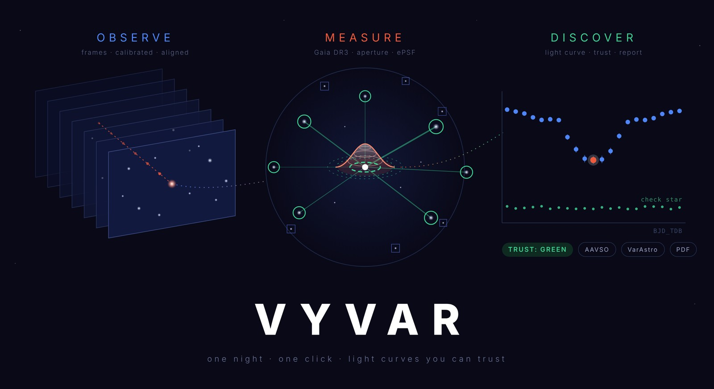
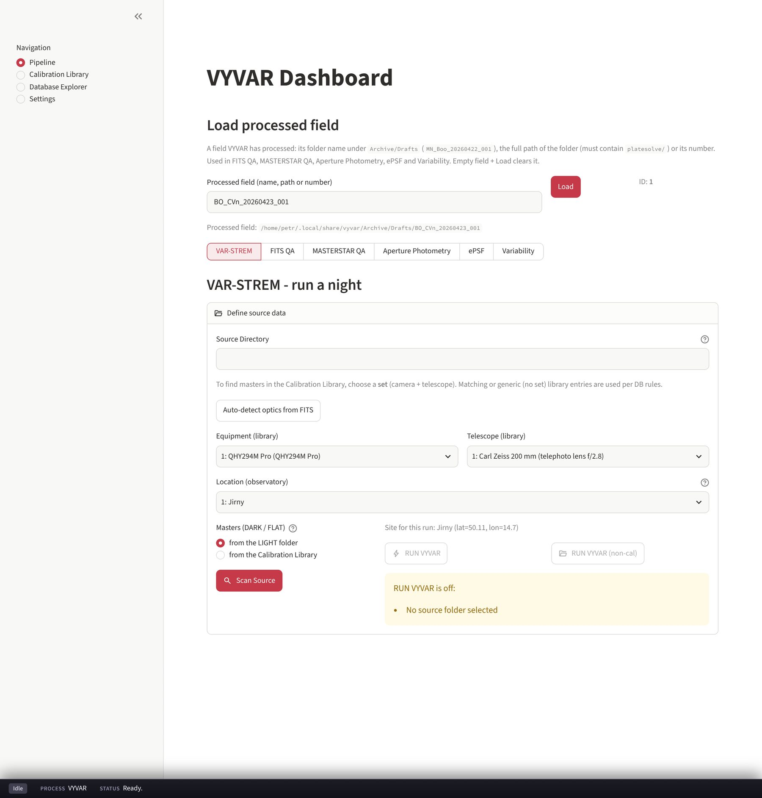
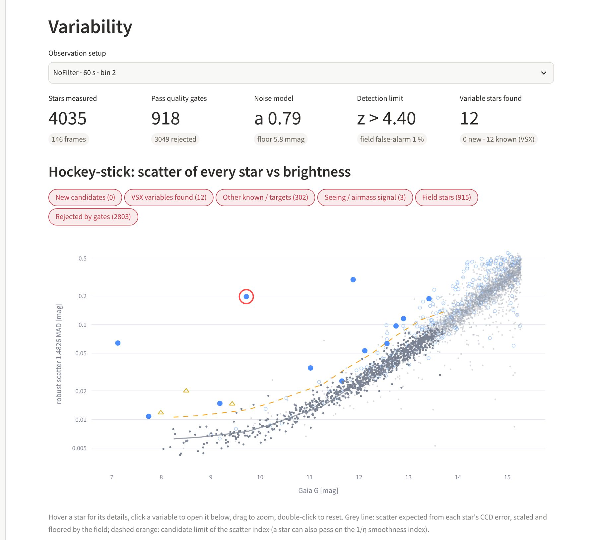
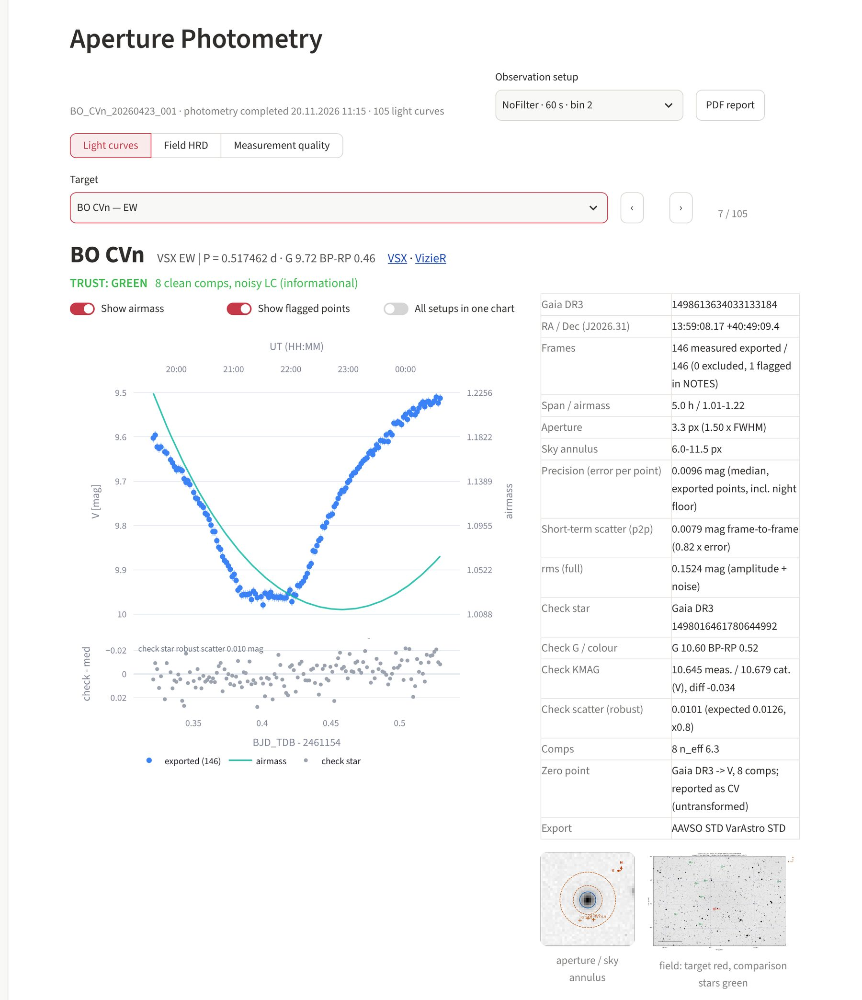

# VYVAR

[Cesky](README_CZ.md)

*Why the name? In Czech and Slovak a vyvar is a broth: everything goes into the pot, simmers for a long time,
and what is left is the essence. VYVAR does the same with a night of frames: the stars cook all night, and what is
left in the morning is the light curve.*

**VYVAR** is a program for differential photometry of variable stars. It takes the FITS images of one observing
night - the science frames ("lights") and the calibration frames - and turns them into light curves of every
known variable star in the field, with an honest error for every point, a judgement of how far each light curve
can be trusted, report files for the AAVSO and VarAstro databases and a PDF report of the night.

VYVAR is written for amateur and small-observatory observers who want results that hold up to professional
scrutiny without tuning each step by hand. One click in the interface (or one command) runs the whole chain, and
every choice the program makes is recorded, so a result can be checked and reproduced.

| | |
|---|---|
| **Current version** | **0.9.0b1** - first public beta |
| **Download** | [Releases](https://github.com/uhlarmilan-create/VYVAR-release/releases): `VYVAR-<version>-win64.zip` (Windows), `VYVAR-<version>-linux-x64.tar.gz` (Linux), `SHA256SUMS` |
| **User manual** | [English (PDF)](docs/VYVAR_Manual_EN.pdf) - [Czech (PDF)](docs/VYVAR_Manual_CZ.pdf) |
| **Installation** | [INSTALL_VYVAR_EN.md](INSTALL_VYVAR_EN.md) (short) - chapter 2 of the manual (full) |
| **License** | Free to download and use, including commercial use - [LICENSE](LICENSE) |

## What a night run does

A night run is one pass through these stages; the manual explains the ideas (chapter 4), the screens (chapter 5)
and the methods with their references (Part III).

| # | Stage | What happens |
|---|-------|--------------|
| 1 | Scan | The source folder is read; every FITS file is classified as light, dark or flat; lights are grouped by filter, exposure and binning. |
| 2 | Import | A new processed field is created; the lights are copied into it. |
| 3 | Calibration | Each light is dark-subtracted and flat-fielded with masters from the calibration library; a calibration gate checks the result. |
| 4 | Frame QC | Every frame is measured (noise, sky, FWHM, elongation, transparency); only real failures are rejected. |
| 5 | Preprocess | The sky background surface is removed, defect pixels are repaired. |
| 6 | Plate solve | The best frame becomes the MASTERSTAR, the reference of the night, plate-solved against Gaia DR3. |
| 7 | Alignment | Every frame is registered onto the MASTERSTAR pixel grid. |
| 8 | Per-frame catalogues | Every star of the MASTERSTAR is measured on every frame. |
| 9 | Targets and comparison stars | Known variables (AAVSO VSX) and exoplanet hosts in the field become targets; comparison stars are chosen for each. |
| 10 | Aperture photometry | Light curves with the ensemble zero point and the full error budget; times in BJD_TDB. |
| 11 | Trust and exports | GREEN / YELLOW / RED verdict per target; AAVSO Extended Format and VarAstro files. |
| 12 | Field search | Search of the whole field for new variable stars. |
| 13 | Report | PDF Summary Measure Report per observation group. |
| 14 | ePSF (optional, beta) | Point-spread-function photometry of the same targets. |

## What you get

- A **light curve** of every target: time (BJD_TDB), calibrated and differential magnitude, the total error and
  each of its parts, airmass and flags.
- **AAVSO Extended Format** and **VarAstro** files ready for submission, with a header that states the method,
  the comparison stars, the check star and the citations of the methods that actually ran.
- A **trust verdict** (GREEN, YELLOW, RED) for every target, with the reasons in plain words.
- The **PDF Summary Measure Report**: a page per target with its light curve, check star and comparison stars,
  plus the field map, a Hertzsprung-Russell diagram of the field, the field variability search and the exact
  settings and code version of the run.
- A list of **new variable-star candidates** found in the field.
- Interactive views of all of this in the graphical interface (a local web page in your browser).

## Cameras and data

- Monochrome cameras with any filter, and one-shot colour (OSC) cameras: OSC images are split into their Bayer
  channels and each channel is measured on its own.
- FITS files as written by the usual capture programs; camera, telescope and observing site are entered once in
  the interface.
- Gaia DR3 is the astrometric and photometric reference; VYVAR builds a local copy of the catalogues once
  (Settings -> Paths and catalogs, or `VYVAR.bat --tool build_gaia`).

## Validation

The aperture photometry is validated end to end. On the same aligned frames, with the same positions, apertures
and comparison stars, independent programs reproduce the VYVAR differential light curves to (rms of the
difference after a constant level, median over 16 light curves): AstroImageJ 1.5 mmag, IRAF DAOPHOT `phot`
1.8 mmag, C-Munipack 3.5 mmag - far below the point-to-point scatter of the light curves themselves. Chapter 21
of the manual gives the details and lists the known limitations. PSF photometry (ePSF) is a beta feature and is off
by default; the published products are always aperture photometry.

## What VYVAR does not do

It does not stack images for deep imaging, does not do image subtraction, does not compute times of minimum or
fit eclipsing-binary models (it writes a Peranso export for programs that do), and does not correct detector
non-linearity or remove cosmic rays.

## System requirements

| | Minimum | Recommended |
|---|---|---|
| Operating system | Windows 10 / 11 (64-bit) or Linux x86-64 with glibc 2.39 (e.g. Ubuntu 24.04) | Windows 11 |
| Memory | 8 GB | 16 GB or more for full nights |
| Disk | 12 GB for the catalogues + 2 GB for the program | 50 GB free for catalogues and data |
| Processor | 4 logical CPUs | 8 or more |
| Network | Needed to build the catalogues; optional during runs | - |

The release package brings its own Python; nothing else has to be installed.

## Quick start

1. Download the package for your system and `SHA256SUMS` from
   [Releases](https://github.com/uhlarmilan-create/VYVAR-release/releases) and check the checksum.
2. Unpack it to a permanent folder.
3. Windows: double-click `VYVAR.bat`. Linux: `chmod +x vyvar.sh` once, then `./vyvar.sh`.
   The interface opens in your browser at `http://localhost:8501`.
4. Check the installation: `VYVAR.bat --selftest` (Linux `./vyvar.sh --selftest`) must end with `SELFTEST PASS`.
5. Build the star catalogues once and enter your site, telescope and camera (manual chapter 2), then process your
   first night (manual chapter 3).

Nights can also be processed from the command line: `VYVAR.bat --night-run -- <options>`
(`VYVAR.bat --night-run -- --help` lists them). The program files are not code-signed, so Windows SmartScreen may
ask before the first start.

## Status and feedback

0.9.0b1 is the first public beta. Check your results before you publish them, and report problems or questions
in [Issues](https://github.com/uhlarmilan-create/VYVAR-release/issues); the run log (`infolog_<time>.txt` in the
processed field) helps to answer them.

## Citing VYVAR

If you publish results obtained with VYVAR, please cite it as described in the manual (appendix "How to cite
VYVAR"), together with the methods listed in the header of your AAVSO / VarAstro files.

## License

VYVAR is free to download and use for any purpose, including commercial use; see [LICENSE](LICENSE). Please
download it only from this repository. Third-party components are listed with their licenses in
`THIRD_PARTY_NOTICES.txt` inside the release package.

Copyright (c) 2026 Milan Uhlar.
