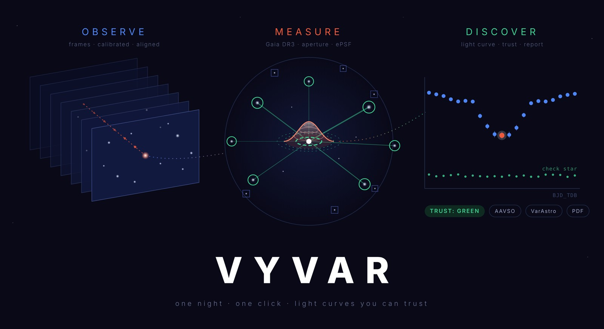
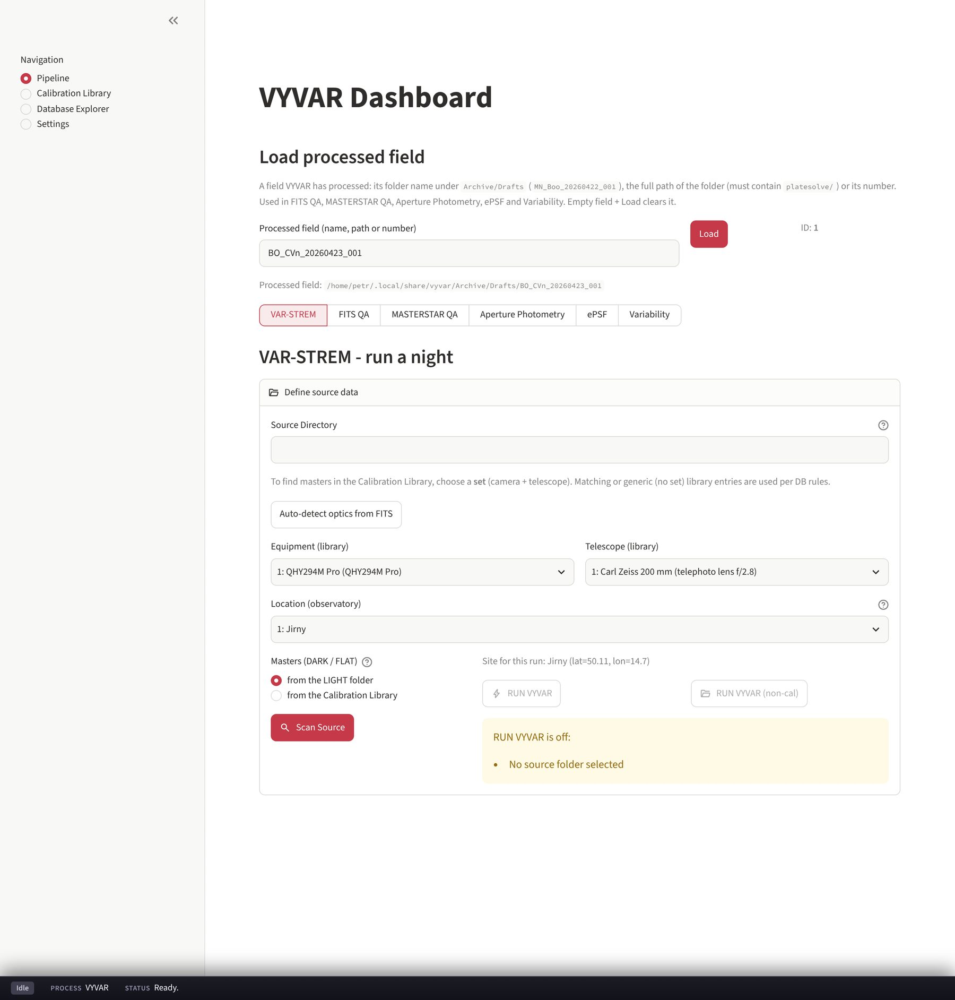
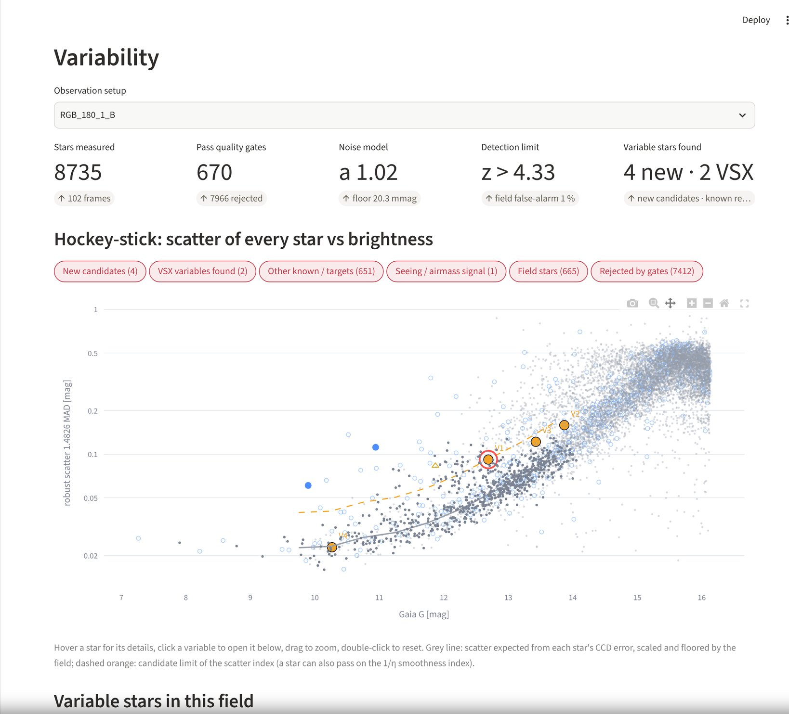
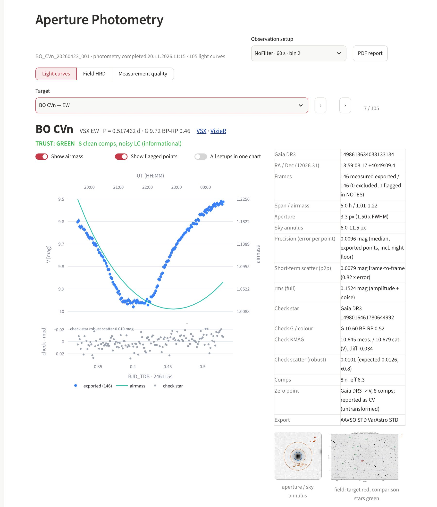

# VYVAR

[English](README.md)

*Proc VYVAR? Vyvar je to, co zustane, kdyz se vsechno da do hrnce a necha dlouho varit: vytazek, podstata. VYVAR
dela totez s noci snimku: hvezdy se vari celou noc a rano zustane svetelna krivka.*

Automaticka diferencialni fotometrie promennych hvezd: od surovych snimku FITS jedne noci po kalibrovane,
astrometricky vyresene svetelne krivky s exportem pro AAVSO a VarAstro a s PDF reporty.

**Ke stazeni:** [Releases](https://github.com/uhlarmilan-create/VYVAR-release/releases) -
`VYVAR-<verze>-win64.zip` (Windows) nebo `VYVAR-<verze>-linux-x64.tar.gz` (Linux) se souborem `SHA256SUMS`.
Aktualni verze: **0.9.0b1 (beta)**.

**Prirucka:** [cesky (PDF)](docs/VYVAR_Manual_CZ.pdf) - [anglicky (PDF)](docs/VYVAR_Manual_EN.pdf).
Kapitola 2 prirucky je navod k instalaci; kratka verze je v [INSTALL_VYVAR_CZ.md](INSTALL_VYVAR_CZ.md).

**Kontakt:** [uhlar.milan@gmail.com](mailto:uhlar.milan@gmail.com?subject=VYVAR) - do predmetu napiste **VYVAR**.

## Co umi

- Jedno tlacitko (nebo jeden prikaz) zpracuje noc: prohledani, kalibrace (dark, flat, knihovna kalibraci),
  kontrola kvality snimku, zarovnani, astrometrie proti Gaia DR3, aperturni fotometrie, ensemble srovnavacich
  hvezd, systematiky, casove znacky (BJD_TDB), statistiky promennosti.
- Cile jsou zname promenne hvezdy a hostitele exoplanet v poli (AAVSO VSX, NASA exoplanet archive);
  novi kandidati promennosti se oznaci.
- Mono i jednosnimkove barevne (OSC) kamery; barevna transformace do pasem Johnson-Cousins podle Gaia.
- Export v AAVSO Extended Format a pro VarAstro, PDF reporty s matici metod a referencemi.
- Rozhrani (mistni webova stranka) a nocni beh z prikazove radky spousteji stejny kod.

## Pozadavky

- Windows 10/11 64bit, nebo Linux x86-64 s glibc 2.39 nebo novejsi.
- Instalacni balicek obsahuje vlastni Python; nic dalsiho neni treba instalovat.
- Misto na disku pro mistni hvezdne katalogy: Gaia DR3 6-40 GB (podle limitni magnitudy), objekty asi 1 GB,
  volitelny index pro astrometrii naslepo asi 7 GB. Katalogy si VYVAR jednou postavi sam.

## Stav

0.9.0b1 je prvni verejna beta. Overenou cestou je aperturni fotometrie (kapitola 21 prirucky); fotometrie ePSF
je oznacena jako beta a ve vychozim stavu je vypnuta. Vysledky pred zverejnenim zkontrolujte a problemy hlaste
v [Issues](https://github.com/uhlarmilan-create/VYVAR-release/issues).
Muzete take napsat autorovi: [uhlar.milan@gmail.com](mailto:uhlar.milan@gmail.com?subject=VYVAR), predmet **VYVAR**.

## Licence

VYVAR je zdarma ke stazeni a pouzivani, vcetne komercniho; viz [LICENSE](LICENSE) (anglicky). Stahujte ho jen
z tohoto repozitare. Komponenty tretich stran a jejich licence jsou v `THIRD_PARTY_NOTICES.txt` v instalacnim
balicku. Publikujete-li vysledky ziskane VYVARem, citujte ho prosim (prirucka, priloha "Jak citovat VYVAR").

Copyright (c) 2026 Milan Uhlar.
